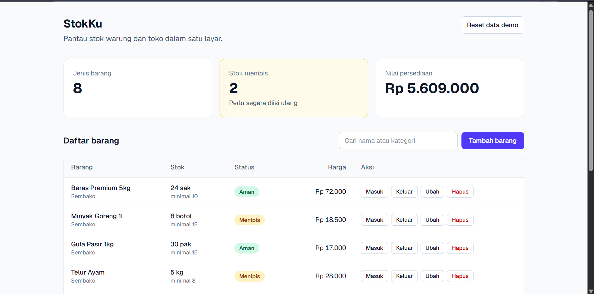

# StokKu

Dashboard stok sederhana untuk warung dan toko kecil. Pantau barang, catat stok masuk dan keluar, dan lihat otomatis mana yang hampir habis, semuanya dalam satu layar.

**Demo langsung:** https://stok-demo-nine.vercel.app/



> Ini proyek demo untuk portofolio. Semua data barang adalah contoh dan tidak mewakili usaha tertentu.

## Masalah yang diselesaikan

Banyak pemilik warung dan toko masih mencatat stok di buku atau ingatan. Akibatnya barang tiba-tiba habis, atau uang tertahan di barang yang menumpuk. StokKu membuat pencatatan itu cepat dan peringatannya otomatis.

## Fitur

- Daftar barang dengan nama, kategori, satuan, stok, batas minimum, dan harga
- Tambah, ubah, dan hapus barang
- Catat **stok masuk** dan **stok keluar** lengkap dengan catatan
- Status otomatis: **Aman**, **Menipis**, dan **Habis**
- Ringkasan: jumlah jenis barang, jumlah stok menipis, dan nilai persediaan
- Riwayat pergerakan stok
- Pencarian berdasarkan nama atau kategori
- Tampilan responsif: kartu di HP, tabel di layar lebar
- Tombol reset untuk mengembalikan data contoh

## Teknologi

- [Next.js](https://nextjs.org) (App Router) dan React
- TypeScript
- Tailwind CSS
- Penyimpanan data di browser (`localStorage`)
- Dihosting di Vercel

## Menjalankan di komputer sendiri

Butuh Node.js versi LTS.

```bash
git clone https://github.com/GoyyPW/stok-demo.git
cd stok-demo
npm install
npm run dev
```

Buka [http://localhost:3000](http://localhost:3000).

## Struktur proyek

```
stok-demo/
├─ app/                  # halaman utama dan layout
├─ components/           # kartu ringkasan, tabel, form, dialog, riwayat
├─ hooks/useInventory.ts # semua logika data (baca, simpan, ubah)
└─ lib/                  # tipe data, data contoh, format rupiah dan tanggal
```

Seluruh logika data berada di satu hook, `useInventory`. Komponen tampilan hanya memanggil fungsinya.

## Catatan tentang data

Pada demo ini data disimpan di browser, jadi hanya ada di perangkat yang dipakai dan akan hilang jika data browser dihapus. Itu sengaja, supaya demo bisa dicoba tanpa daftar akun.

Untuk penggunaan sungguhan, penyimpanan bisa diganti dengan database online (misalnya Supabase) beserta login pengguna, sehingga data aman dan bisa diakses dari beberapa perangkat. Karena logika data terpusat di `useInventory`, perubahan itu tidak menyentuh komponen tampilan.

## Ingin sistem seperti ini untuk usahamu?

Saya menerima pembuatan website dan sistem kecil untuk UMKM, termasuk penyesuaian fitur, login, dan penyimpanan online.

- Kontak: Email : yog2987@gmail.com atau WA : 081515679413
- Portofolio lain: https://github.com/GoyyPW/toko-demo
